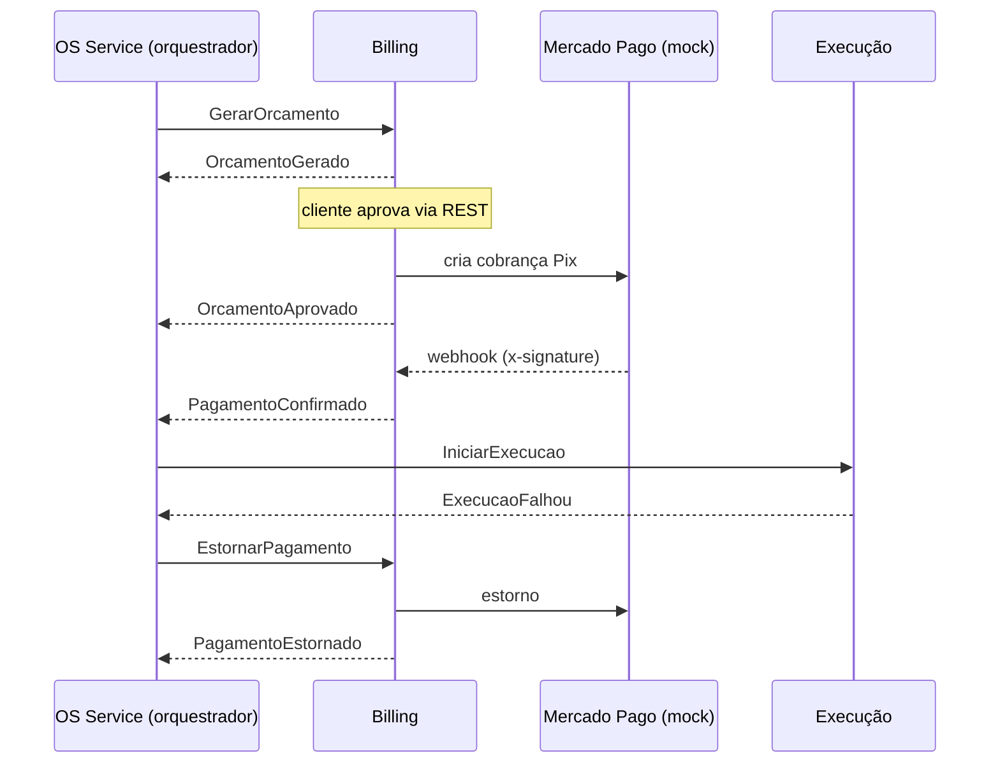

# Wrench Billing Service

Microsserviço de **orçamento, aprovação, pagamento (Pix) e estorno** da Wrench Auto Repair
(Tech Challenge, Fase 4, grupo BGT³). Faz parte da Saga orquestrada da Ordem de Serviço: o orquestrador
vive no OS Service e este serviço reage aos comandos dele e publica o resultado de cada etapa.

> **Pagamento mockado.** O Mercado Pago está atrás da porta `IPagamentoGateway` e a implementação atual é um
> **mock** (`MockPagamentoGateway`). O webhook, a validação de `x-signature` e a idempotência são reais e
> testados; só o provedor é simulado. Para usar o sandbox real, implemente `IPagamentoGateway` (com o id do
> orçamento como `X-Idempotency-Key`) e troque o registro em `wrench.billing.infra/DependencyInjection.cs`.

## Arquitetura

Mesma convenção de pastas e nomes dos demais serviços (`wrench.<serviço>.<camada>`):

```
wrench.billing.sln
src/
  wrench.billing.domain        Orcamento, Pagamento, WebhookEvento (regras e transições de estado)
  wrench.billing.application   Services/, Responses/, Options/, Exceptions/, Webhooks/, Extensions/,
                               Abstractions/ (portas), Consumers/, Contracts/ (mensagens)
  wrench.billing.infra         EF Core + Npgsql, outbox/inbox, MassTransit + SQS, gateway mock, worker
  wrench.billing.api           Controllers, Models, Options, Configuration, Middlewares, Program.cs
tests/
  wrench.billing.tests         xUnit (Api, Application, Domain, Infra, Support) + coverage.runsettings
chart/                         chart Helm (wrench-billing)
terraform/                     database e role do Billing no RDS (ver terraform/README.md)
```

| Tema | Decisão |
|---|---|
| Banco | PostgreSQL `wrench_billing`, exclusivo do serviço. Nenhum outro serviço o acessa. |
| Mensageria | Amazon SNS + SQS via MassTransit 8.5.x (a linha 9.x é comercial), fila por consumer com prefixo `billing-`. |
| Consistência | **Outbox transacional**: estado e evento são gravados na mesma transação. **Inbox**: reentrega do SQS (at-least-once) não reprocessa. |
| Retry | Exponencial (5 tentativas). `DomainException` e `NaoEncontradoException` não sofrem retry e vão para a fila de erro/DLQ. |
| Idempotência | Transições de domínio retornam `false` se já aplicadas; `pagamentos.ExternalId` é único; webhooks guardam a chave em `webhook_eventos`. |
| Webhook | Valida `x-signature` (HMAC-SHA256) e **consulta o status no provedor** em vez de confiar no corpo. |
| Plano B do webhook | `PagamentoReconciliacaoWorker` consulta pagamentos pendentes e expira os Pix vencidos (30 min). |

### Consistência e idempotência

- Cada caso de uso grava o novo estado e publica o evento na mesma transação (outbox).
- Comandos reentregues não duplicam efeito: gerar orçamento devolve o existente, aprovar devolve a cobrança já criada,
  cancelar e estornar reafirmam o resultado.
- Pagamento aprovado no provedor para uma cobrança já expirada ou cancelada localmente não publica confirmação;
  só gera log de erro (exige estorno manual).

## Eventos

Toda mensagem carrega `OrdemServicoId` e `CorrelationId`. O `CorrelationId` é **texto livre**, como no
`execucao-service`, e viaja no header `correlationId`; quando é um GUID também vira o CorrelationId do transporte.

Os contratos estão em `src/wrench.billing.application/Contracts/Mensagens.cs` e devem ser trocados pelo pacote
compartilhado `Wrench.Contracts` v1 quando for publicado (mudanças apenas aditivas).

**Consome (comandos do orquestrador)**

| Mensagem | Efeito |
|---|---|
| `GerarOrcamento` | Cria o orçamento, envia ao cliente e publica `OrcamentoGerado` (ou `OrcamentoFalhou` se os dados forem inválidos). |
| `CancelarOrcamento` | Compensação: cancela orçamento e cobrança pendente; publica `OrcamentoCancelado`. |
| `EstornarPagamento` | Compensação: estorna o pagamento confirmado; publica `PagamentoEstornado` ou `EstornoFalhou`. |

**Publica**

| Evento | Quando |
|---|---|
| `OrcamentoGerado` / `OrcamentoFalhou` | Resultado de `GerarOrcamento`. |
| `OrcamentoAprovado` | Cliente aprovou; cobrança Pix criada (traz o Pix copia-e-cola e a expiração). |
| `OrcamentoRecusado` | Cliente recusou. |
| `OrcamentoCancelado` | Resultado de `CancelarOrcamento`. |
| `PagamentoConfirmado` | Webhook ou conciliação confirmou o pagamento. |
| `PagamentoFalhou` | Pagamento recusado, cancelado no provedor ou expirado (o Billing já cancela cobrança e orçamento). |
| `PagamentoEstornado` / `EstornoFalhou` | Resultado de `EstornarPagamento`. |



| Falha | Reação do Billing |
|---|---|
| Orçamento inválido | `OrcamentoFalhou` |
| Cliente recusa | `OrcamentoRecusado`; o orquestrador envia `CancelarOrcamento` |
| Pagamento recusado ou expirado | Cancela cobrança e orçamento; `PagamentoFalhou` |
| Execução não aceita a OS | `EstornarPagamento` → `PagamentoEstornado` (ou `EstornoFalhou`) |

## API (`/api/v1`)

Documentação interativa em `/docs-ui` e especificação em `/openapi/v1.json`. Versionamento pela URL.

| Método | Rota | Perfis | Descrição |
|---|---|---|---|
| GET | `/orcamento/{id}` | Admin, Funcionario, Cliente | Consulta orçamento |
| GET | `/orcamento/ordem-servico/{ordemServicoId}` | Admin, Funcionario, Cliente | Orçamento mais recente da OS |
| PUT | `/orcamento/{id}/aprovar` | Cliente | Aprova e devolve a cobrança Pix |
| PUT | `/orcamento/{id}/recusar` | Cliente | Recusa (`{ "motivoRecusa": "..." }`, opcional) |
| GET | `/pagamento/orcamento/{orcamentoId}` | Admin, Funcionario, Cliente | Consulta o pagamento |
| POST | `/pagamento/webhook` | pública + `x-signature` | Notificação do provedor |
| POST | `/simulacao/pagamentos/{orcamentoId}/{aprovado\|recusado\|expirado}` | Admin, Funcionario | **Somente mock**: define o resultado e dispara o webhook assinado |
| GET | `/health` e `/health/ready` (fora de `/api/v1`) | pública | Liveness e readiness (inclui o banco) |

Erros: `401` token ou assinatura inválidos, `403` perfil sem permissão, `404` não encontrado, `409` transição de estado inválida.

> `aprovar` e `recusar` mantêm o caminho e o perfil do `OrcamentoController` do monólito. O OS Service extraído
> não deve mais expor `/orcamento/*`, e o API Gateway precisa rotear `/api/v1/orcamento` e `/api/v1/pagamento`
> (incluindo o webhook público) para este serviço. O `{id}` do orçamento é gerado aqui e chega ao OS Service no
> evento `OrcamentoGerado`.

## Modelo de dados (PostgreSQL)

Migration `Inicial` em `src/wrench.billing.infra/Persistence/Migrations`: `orcamentos`, `orcamento_itens`,
`pagamentos`, `webhook_eventos` e as tabelas de outbox/inbox do MassTransit.

```powershell
dotnet tool restore
dotnet tool run dotnet-ef migrations add <Nome> --project src/wrench.billing.infra --output-dir Persistence/Migrations
```

O database `wrench_billing` e o role de menor privilégio são criados por `terraform/`.

## Configuração

Variáveis de ambiente usam `__` (ex.: `Pagamento__WebhookSecret`).

| Chave | Descrição |
|---|---|
| `ConnectionStrings:Billing` | Postgres do Billing |
| `Database:MigrateOnStartup` | Aplica migrations ao subir |
| `Database:UseInMemory` | Banco em memória (testes) |
| `Messaging:Transport` | `Sqs` ou `InMemory` |
| `Messaging:Region` / `Messaging:ServiceUrl` | Região AWS / endpoint (LocalStack) |
| `Pagamento:WebhookSecret` | Segredo da validação do `x-signature` |
| `Pagamento:ExpiracaoPixMinutos` | Validade do Pix (padrão 30) |
| `Pagamento:ReconciliacaoIntervaloSegundos` | Intervalo da conciliação (padrão 30) |
| `Pagamento:Mock:FalharEstorno` | Força `EstornoFalhou` (demonstração) |
| `Simulacao:Habilitada` | Expõe `/api/v1/simulacao` (nunca em produção) |
| `Simulacao:WebhookBaseUrl` | Endereço pelo qual a simulação chama o webhook do próprio serviço |
| `JwtOptions:Secret/Issuer/Audience` | Mesmos valores do OS Service e da lambda de autenticação (a aplicação não sobe sem eles) |

Credenciais AWS vêm do IRSA no EKS (sem chaves estáticas). Segredos nunca entram no repositório.

## Como rodar

```powershell
# Postgres + API em http://localhost:8082/docs-ui (barramento em memória, simulação habilitada)
docker compose up --build

# Ou direto, com um Postgres local já em execução (perfil Development)
dotnet run --project src/wrench.billing.api
```

Sem SNS/SQS local, a Saga completa só pode ser exercitada em homologação. Localmente é possível percorrer
orçamento → aprovação → pagamento com a API de simulação (precisa de um token JWT com perfil Cliente e outro Admin).

## Testes e cobertura

```powershell
dotnet test --collect:"XPlat Code Coverage" --settings tests/wrench.billing.tests/coverage.runsettings
reportgenerator "-reports:tests/**/coverage.cobertura.xml" "-targetdir:coverage-report" "-reporttypes:TextSummary;Html"
```

Resultado atual: 119 testes e cerca de 99% de cobertura de linhas (a exigência é 80%). O `coverage.runsettings` exclui
apenas `Program.cs`, migrations e código gerado, e é obrigatório passá-lo com `--settings` (sem ele as migrations entram
na conta). Os testes cobrem domínio, serviços, consumers, assinatura do webhook, gateway mock, DI, worker, propagação do
`correlationId` e a API inteira via `WebApplicationFactory`, com banco e barramento em memória.

## Deploy

Imagem: `Dockerfile` (multi-stage). Chart Helm em [`chart/`](chart): Deployment, Service, ServiceAccount (IRSA), Secret,
TargetGroupConfiguration e a rota `/api/v1/orcamento` + `/api/v1/pagamento` no Gateway compartilhado `bgt3-gw`.
Namespace e Gateway **não** pertencem a este chart.

```powershell
helm upgrade --install wrench-billing ./chart -n production `
  --set image.repository=<ECR>/wrench/billing-api --set image.tag=<tag> `
  --set database.user=<role> --set database.password=<senha> `
  --set pagamento.webhookSecret=<segredo> `
  --set jwt.secret=<segredo> `
  --set serviceAccount.roleArn=<role-irsa-sns-sqs>
```

O chart mantém **1 réplica** e o autoscaling desligado enquanto o gateway for o mock, porque o estado simulado fica em memória.

A pipeline `.github/workflows/ci.yml` faz restore, build, testes com cobertura mínima de 80% e `helm lint`.
Falta a parte de SonarCloud, imagem no ECR e deploy no EKS, que dependem do workflow reutilizável da plataforma.

## Pendências conhecidas

- Pipeline completa (SonarCloud, ECR, deploy Helm): depende do workflow reutilizável do Thiago.
- Observabilidade: falta instrumentar OpenTelemetry e Serilog como no `execucao-service` (traces para o New Relic,
  com `traceparent` nas mensagens).
- **Formato de mensagem entre serviços**: o `execucao-service` publica JSON puro no SNS (atributos `messageId`, `tipo`,
  `correlationId`, `traceparent`), enquanto este serviço usa o envelope do MassTransit. É preciso decidir com o grupo
  um único formato e a topologia de tópicos (um por publicador, segundo o plano) antes da integração.
- Contratos locais: trocar por `Wrench.Contracts` v1 e alinhar nomes e campos com os demais serviços.
- E-mail do orçamento: o `LogOrcamentoNotificador` só registra o envio; a troca por Amazon SES é uma nova
  implementação de `IOrcamentoNotificador`.
- BDD do fluxo completo (Reqnroll), incluindo o cenário de estorno.
- `docker build` e `helm lint` ainda não foram executados neste ambiente (sem daemon Docker e sem Helm instalados).
